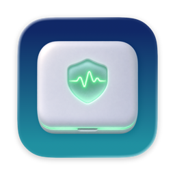
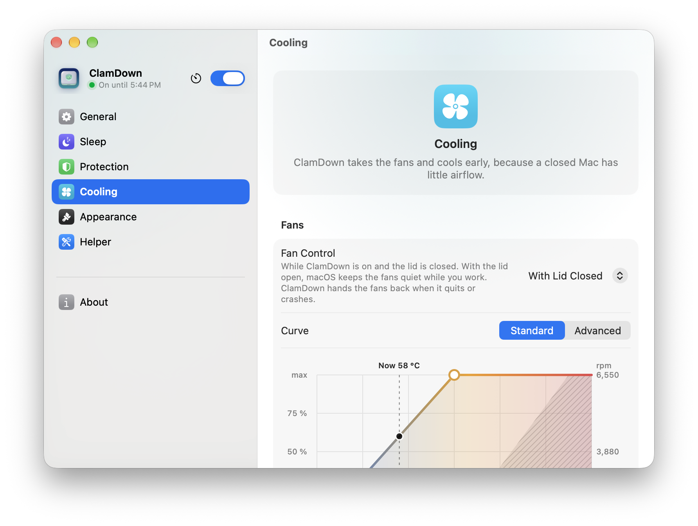
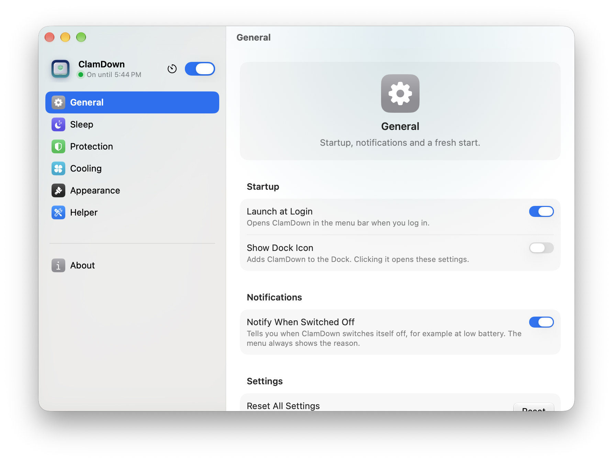

<p align="center">
  
</p>

<h1 align="center">ClamDown</h1>

<p align="center"><b>Close the lid. Your agents keep working.</b></p>

<p align="center">
  <a href="https://github.com/delef/ClamDown/releases/latest"></a>
  
  <a href="LICENSE"></a>
</p>

<p align="center">
  <a href="https://github.com/delef/ClamDown/releases/latest/download/ClamDown.dmg"><b>Download ClamDown.dmg</b></a> · <a href="https://clamdown.app">clamdown.app</a>
</p>

ClamDown is a free, open-source menu bar app that keeps coding agents working on your MacBook with the lid closed. Start a long task in Claude Code, Codex or any other agent, close the lid and put the Mac away: the agent keeps going on your own machine.

No more carrying the laptop half-open with a thumb in the hinge, and no paid cloud sessions just so a task survives a closed lid.

**Everything a closed laptop needs, in one app:**

- **Stays awake with the lid shut.** Agents, terminals, browsers, SSH sessions and downloads keep running.
- **Keeps it cool.** Watches the hottest of its temperature sensors and drives the fans along a curve you choose while the lid is closed, where macOS would leave them near idle, or all the time if you like.
- **Keeps it locked.** Locks the screen the moment the lid closes.
- **Knows when to stop.** Switches itself off and lets the Mac sleep before a low battery or high heat becomes a problem, or when your timer ends.
- **Can't get stuck on.** A root helper with a watchdog puts sleep, Low Power Mode and the fans back if the app quits, crashes or stops responding.

<p align="center">
  <picture>
    <source media="(prefers-color-scheme: dark)" srcset="docs/screenshots/cooling-dark.png">
    
  </picture>
  <picture>
    <source media="(prefers-color-scheme: dark)" srcset="docs/screenshots/protection-dark.png">
    
  </picture>
</p>
<p align="center">
  <picture>
    <source media="(prefers-color-scheme: dark)" srcset="docs/screenshots/sleep-dark.png">
    
  </picture>
  <picture>
    <source media="(prefers-color-scheme: dark)" srcset="docs/screenshots/general-dark.png">
    
  </picture>
</p>

### Why not Caffeine, `caffeinate` or a similar tool?

- **Keep-awake apps and `caffeinate`** hold a power assertion. macOS ignores it the moment the lid closes, unless an external display and power are connected.
- **A dummy display plug or an external monitor** keeps the Mac in clamshell mode, but only while it is plugged in, and with no battery, heat or fan safeguards.
- **An app that only keeps the Mac awake with the lid closed** solves half the problem. macOS keeps a closed MacBook's fans near idle even when the chip is hot, so the Mac heats up, and on battery nothing stops the agent from draining it to empty.
ClamDown keeps a closed Mac awake, drives the fans and watches the battery and the heat, so you can close the lid and stop thinking about it.

## What it does

- One switch in the menu bar. Filled icon: on. Outline icon: off. "Turn On For" starts a timed session. The icon style is a setting.
- While on, closing the lid does not sleep the Mac. Running processes and network connections carry on.
- While on, closing the lid locks the screen (setting, on by default), so the Mac does not open without a password.
- It drives the fans from the hottest temperature sensor: the CPU, GPU, battery, SSD, Wi-Fi and airflow sensors, whichever is hottest. The CPU and GPU count the way macOS's own fan control reads them: as the temperature of the chip's die zone (SMC keys `Tf14` and `Tf24`, confirmed against `TCDX` on every reading), averaged over about half a minute. A zone runs about 14 °C under the hottest core and barely moves when a few cores spike for a few seconds, so a short burst does not make the fans roar. Where macOS waits until a zone nears about 76 °C, ClamDown follows its own curve from 40 °C. The other sensors follow the case and count as read, so a Mac warming in a bag still reaches full speed. On a Mac without the zone keys, a chip counts as its hottest sensor averaged over about a minute. macOS keeps a closed MacBook's fans near their lowest speed even when the chip is hot, and lets an open one run hot before they speed up. Fan control needs Apple Silicon; on an Intel Mac the Cooling page only shows the readings. Fan Control decides when ClamDown raises the fans along a curve, and the setup assistant asks once:
  - **With Lid Closed** (default): while ClamDown is on and the lid is closed. With the lid open, macOS keeps the fans quiet while you work.
  - **Always**: with the lid open too, also while ClamDown is off. Cooler, and louder. It needs the app running and the helper set up.
  - **Never**: macOS keeps the fans.
- The curve comes in two forms:
  - **Standard:** two points. By default the fans speed up from 40 °C and reach full speed at 70 °C (both settings).
  - **Advanced:** five points you drag on a chart.
- Under any curve sits a safety floor that ClamDown never goes under: from 70 °C the fans rise in a straight line to full speed at 95 °C. The fans run at the faster of the curve and the floor.
- The case has its own rule, because it can feel hot while the chips are only warm: the fans also follow the airflow sensors, from 0 % at 38 °C to full speed at 44 °C. Both temperatures can be changed on the Cooling page. The fans run at the fastest of the curve, the floor and the case rule.
- The fans go to full speed when a CPU core sits at its limit, when the battery reaches 45 °C (until it has been under 43 °C for 30 seconds), or when macOS reports the Mac as hot.
- If ClamDown cannot control the fans, it hands them back to macOS and tries again by itself. When it has stopped, it tells you once: a line in the menu and, with notifications on, one notification.
- On battery, it switches on Low Power Mode for the battery profile (setting, on by default) and puts your previous value back when it switches off.
- It switches itself off and lets the Mac sleep when:
  - the battery falls to the cut-off (default 10%, setting: 5–50% or off), or
  - the system thermal state reaches the cut-off (default `serious`, setting: `fair`, `serious`, `critical`, or never), or
  - the battery has stayed at or above its limit for the hold time (default 55 °C for 1 minute, setting: 50–60 °C, 30 seconds to 5 minutes, or off), or
  - the power adapter is unplugged (setting, off by default), or
  - the timer ends (setting: never, or 30 minutes to 8 hours).
- After a battery or heat switch-off with nobody at the Mac, it puts the Mac to sleep (setting, on by default), so an app that keeps the Mac awake cannot leave it running in a bag. Nobody is at the Mac when the lid is closed, no external display is connected, and the keyboard and pointer have been still for a minute. If the Mac does not fall asleep, ClamDown asks again, three times in all. It leaves the Mac alone when the lid is open, a display is connected, or someone has just typed.
- When you open the lid after ClamDown let the Mac sleep, it tells you why, in a window that stays until you close it.
- It posts a notification that names the reason whenever it switches itself off (setting, on by default).

Settings has six pages: General, Sleep, Protection, Cooling, Appearance and Helper. The Cooling page has the Fan Control choice, the curve chart, the case rule's two temperatures, the hottest temperature and each sensor group's, each fan's speed and whether ClamDown or macOS controls the fans. The Helper page shows the helper's state and can reinstall or remove it.

## Requirements

macOS 13 or later. A universal app for Apple Silicon and Intel Macs; fan control needs Apple Silicon. Verified on Apple Silicon.

## Install

Download the notarized `ClamDown.dmg` from the [latest release](https://github.com/delef/ClamDown/releases/latest), open it, and drag ClamDown to Applications. Or build it yourself (see below).

## Updates

ClamDown checks GitHub for a new version once a day and asks before it installs one. The check downloads the release feed (`appcast.xml`) from GitHub Releases and sends nothing about you or your Mac. Turn it off, or check by hand, in Settings > General > Updates, or choose Check for Updates… in the menu.

Updates go through [Sparkle](https://sparkle-project.org). Each update must carry an EdDSA signature from the ClamDown release key, and macOS checks the Developer ID signature and notarization as usual.

Version 0.1.0 has no updater: install a newer release by hand once.

## First run

The first launch opens a setup assistant. It takes about a minute:

1. **Allow the helper.** ClamDown needs a small root helper to change sleep settings and drive the fans. "Allow…" registers it and opens System Settings > General > Login Items & Extensions; switch ClamDown on there. The assistant notices by itself and comes back to the front.
2. **Notifications** (optional). With the lid closed you cannot see the menu, so a notification tells you when ClamDown switched itself off.
3. **Launch at Login** (optional), with a list of the protection that is already on.
4. **Turn On Now**, or Done.

You can close the assistant at any step; the menu then offers "Finish Setup…". Settings > Helper > Setup Assistant opens it again.

When ClamDown cannot work until you do something, for example after macOS took the helper's approval back, the menu bar icon carries a small exclamation mark and the Dock icon, when shown, a "!" badge.

## Safety behavior

- **Cut-offs.** Battery, battery heat and thermal cut-offs switch ClamDown off and let the Mac sleep. The battery rule applies only while running on battery, so a charging Mac at 5% stays awake. Macs without a battery have no battery rule.
- **Watchdog.** While on, the app sends the helper a heartbeat about every 30 seconds. If the heartbeat stops for about 90 seconds, or the app quits or crashes, the helper puts sleep, Low Power Mode and the fans back as they were, by itself. If the lid is then closed for sleep and the keyboard and pointer have been still for a minute, the helper also puts the Mac to sleep; it stops trying when someone opens the lid, and after five minutes.
- **Fans.** The helper hands the fans back to macOS whenever the mode switches off for any reason, you set Fan Control to Never, the lid opens (with "With Lid Closed"), the app quits or stops checking in while ClamDown is off (with "Always"), the Mac goes to sleep while ClamDown is off, no temperature can be read, or it cannot set a fan; after an error it tries again by itself. It records that it holds the fans before it touches them, so a helper restart after a crash hands them back too. It applies the safety floor itself, so a wrong curve from the app cannot take the fans below it, and it never sets a fan outside that fan's own minimum and maximum speed. Fan speed rises at once and falls by at most 150 rpm every 3 seconds, so short dips in load do not make the fans hunt.
- **Reboots.** The helper runs at load and resets any leftover state every time it starts.
- **Original settings.** The first time ClamDown switches on, the helper records your sleep and Low Power Mode settings and never replaces that record. Remove Helper in Settings > Helper puts them back first; if they cannot be put back, the helper stays installed.
- **Narrow helper.** The helper can only keep the Mac from sleeping or let it sleep again, turn Low Power Mode on or off for the battery profile, read both values, read the temperature sensors and fans, and set fan speeds within each fan's own range while the mode is on, or while the app keeps asking for it with Fan Control set to Always; if handing the fans back to macOS fails, it runs them at full speed until the hand-back works. It accepts connections only from the signed ClamDown app (same Team ID, same bundle identifier).

## Security note

With the mode on, closing the lid locks the screen by default. If you turn off "Lock Screen When Closed", opening the lid brings you straight back to an unlocked session; lock the Mac yourself (Control-Command-Q) before you leave it unattended.

## Uninstall

Switch ClamDown off, use Remove Helper in Settings > Helper (it puts back the sleep and Low Power Mode settings you had before ClamDown first switched on), quit it, then delete the app. If the fans stay at a fixed speed afterwards, restart the Mac: the fans go back to macOS control on restart. If the Mac refuses to sleep afterwards, or Low Power Mode is wrong, put them back by hand:

```
sudo pmset disablesleep 0
sudo pmset -b lowpowermode 0   # or 1, whichever you had before
```

## Build from source

You need Xcode with a Swift 6 toolchain and a code-signing identity.

```
cp Config/Signing.xcconfig.example Config/Signing.local.xcconfig
# edit Config/Signing.local.xcconfig: your bundle ID and signing identities
swift test
scripts/build-app.sh debug      # Apple Development identity; use "release" for Developer ID
scripts/verify-bundle.sh
```

User-visible text lives in `Resources/Localizable.xcstrings`, which `scripts/sync-strings.sh` refreshes from the code.

`scripts/coverage.sh` runs the tests with code coverage and fails when the helper, sensor, shared or app module drops under its limit; CI runs it on every pull request. `swift test --repeat-until fail --maximum-repetitions 100` looks for a test that fails only now and then; the `flaky` workflow does the same every week. The sensor tests replay real SMC key dumps from `Tests/ClamDownSensorsTests/Fixtures`; `.build/debug/ClamDownFanProbe keys "<machine>"` takes a new one without root.

For a release:

1. Raise `CFBundleShortVersionString` and `CFBundleVersion` in `Resources/Info.plist.template`. Sparkle compares `CFBundleVersion`, so it must grow with every release.
2. `scripts/build-app.sh release`, then `scripts/notarize.sh` (notarizes and staples the app), then `scripts/make-dmg.sh` (packs it into a signed, notarized `build/ClamDown.dmg`). Notarization uploads the app and the disk image to Apple and needs a `notarytool` keychain profile (`xcrun notarytool store-credentials`).
3. `scripts/make-appcast.sh` signs the disk image with the Sparkle EdDSA key and writes `build/appcast.xml`. It refuses to finish if the signature does not match `SUPublicEDKey` in the app. The private key lives outside the repository, in `CLAMDOWN_SPARKLE_KEY_FILE` (default `~/.config/clamdown/sparkle-ed25519.key`).
4. `gh release create vX.Y.Z build/ClamDown.dmg build/appcast.xml`. Installed copies find the new version through `releases/latest/download/appcast.xml`.

`scripts/stats.sh` prints GitHub's download counters for each release: disk image downloads, and update checks, which approximate how many copies are in use each day.

The helper only talks to an app signed with the same Team ID as itself, so a build signed with your own identity works with its own helper and with no one else's.

## License

Apache License 2.0. See [LICENSE](LICENSE).

The app bundles [Sparkle](https://github.com/sparkle-project/Sparkle) (MIT license), whose license ships as `Contents/Resources/Sparkle-LICENSE.txt`.
