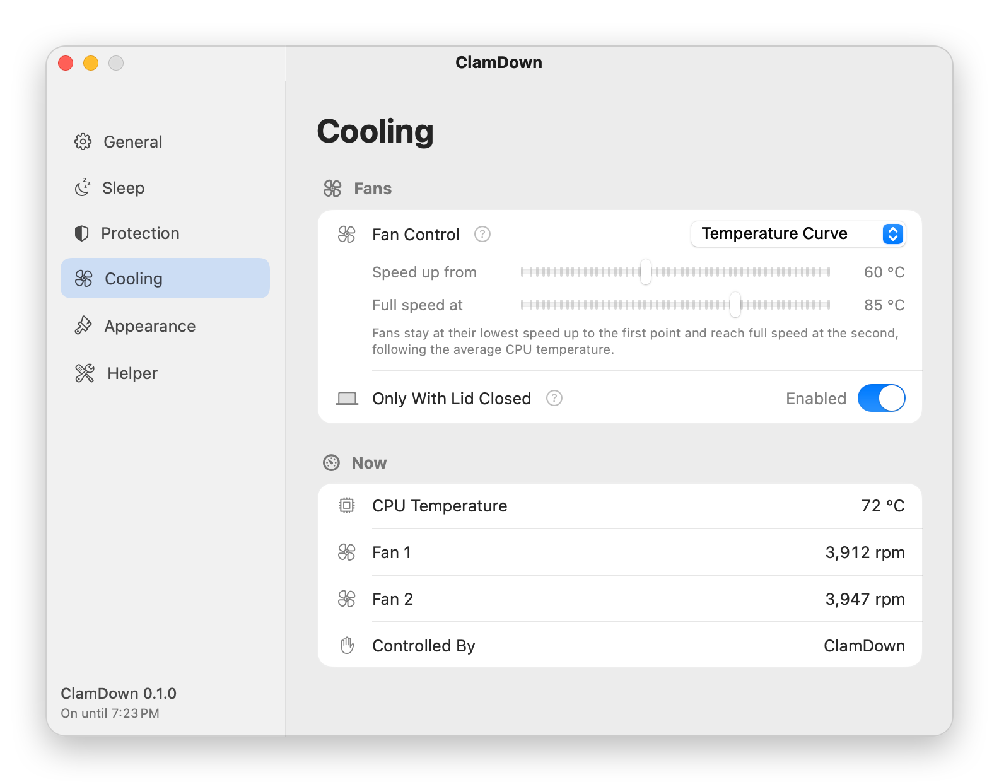
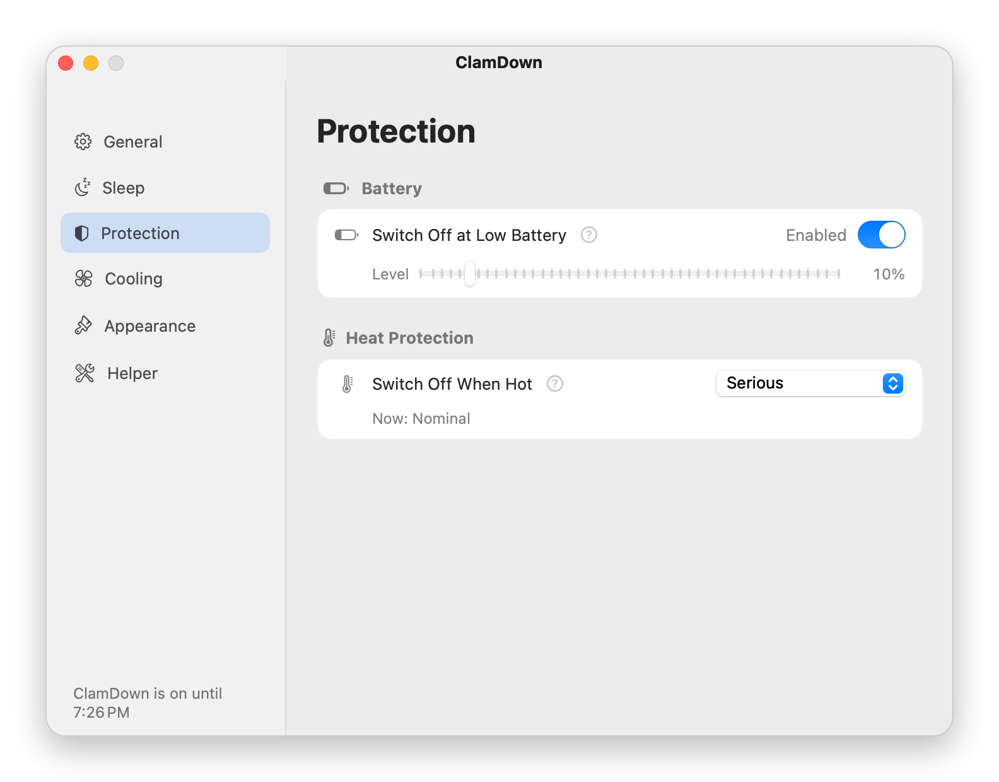
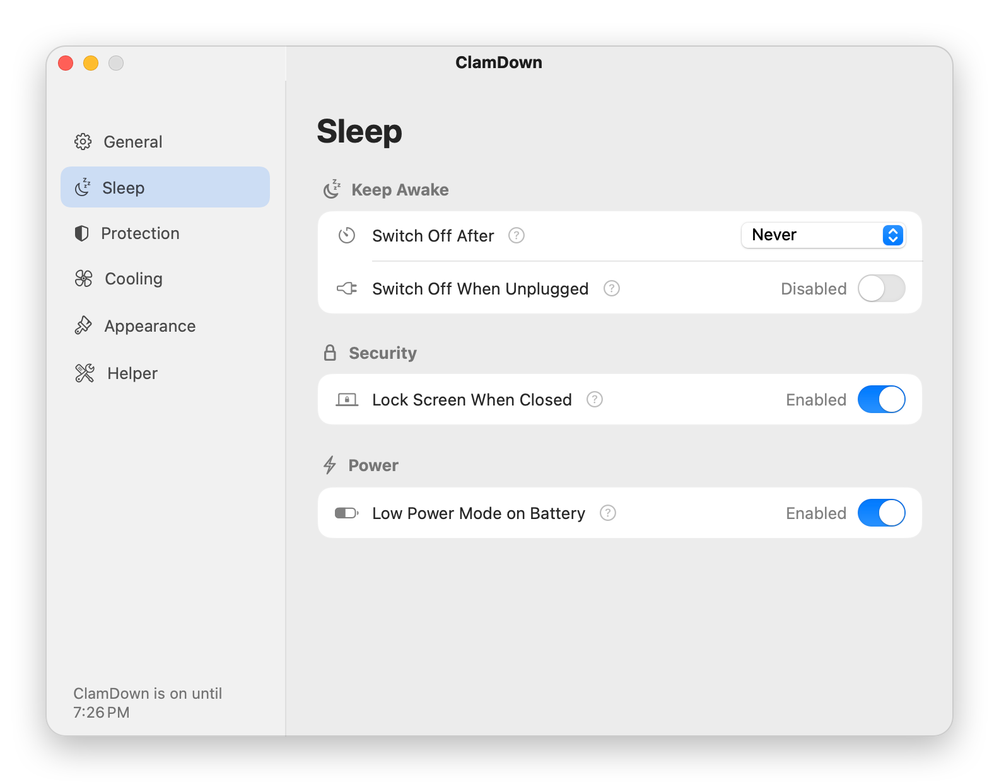
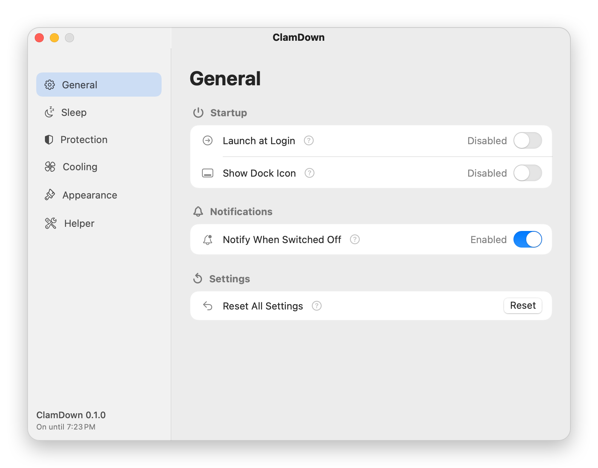

<p align="center">
  
</p>

<h1 align="center">ClamDown</h1>

<p align="center"><b>Close the lid. Your agents keep working.</b></p>

<p align="center">
  <a href="https://github.com/delef/ClamDown/releases/latest"></a>
  
  <a href="LICENSE"></a>
</p>

<p align="center">
  <a href="https://github.com/delef/ClamDown/releases/latest/download/ClamDown.dmg"><b>Download ClamDown.dmg</b></a> · <a href="https://clamdown.app">clamdown.app</a>
</p>

ClamDown is a free, open-source menu bar app that keeps coding agents working on your MacBook with the lid closed. Start a long task in Claude Code, Codex or any other agent, close the lid and put the Mac away: the agent keeps going on your own machine.

No more carrying the laptop half-open with a thumb in the hinge, and no paid cloud sessions just so a task survives a closed lid.

**Everything a closed laptop needs, in one app:**

- **Stays awake with the lid shut.** Agents, terminals, browsers, SSH sessions and downloads keep running.
- **Keeps it cool.** Watches the CPU temperature and drives the fans along a curve while the lid is closed, where macOS would leave them near idle.
- **Keeps it locked.** Locks the screen the moment the lid closes.
- **Knows when to stop.** Switches itself off and lets the Mac sleep before a low battery or high heat becomes a problem, or when your timer ends.
- **Can't get stuck on.** A root helper with a watchdog puts sleep, Low Power Mode and the fans back if the app quits, crashes or stops responding.

<p align="center">
  <picture>
    <source media="(prefers-color-scheme: dark)" srcset="docs/screenshots/cooling-dark.png">
    
  </picture>
  <picture>
    <source media="(prefers-color-scheme: dark)" srcset="docs/screenshots/protection-dark.png">
    
  </picture>
</p>
<p align="center">
  <picture>
    <source media="(prefers-color-scheme: dark)" srcset="docs/screenshots/sleep-dark.png">
    
  </picture>
  <picture>
    <source media="(prefers-color-scheme: dark)" srcset="docs/screenshots/general-dark.png">
    
  </picture>
</p>

### Why not Caffeine, `caffeinate` or a similar tool?

- **Keep-awake apps and `caffeinate`** hold a power assertion. macOS ignores it the moment the lid closes, unless an external display and power are connected.
- **A dummy display plug or an external monitor** keeps the Mac in clamshell mode, but only while it is plugged in, and with no battery, heat or fan safeguards.
- **An app that only keeps the Mac awake with the lid closed** solves half the problem. macOS keeps a closed MacBook's fans near idle even when the chip is hot, so the Mac heats up, and on battery nothing stops the agent from draining it to empty.
- **`sudo pmset disablesleep 1` by hand** does survive a closed lid, but nothing watches the battery or the temperature, the fans stay near idle, the screen stays unlocked, and it stays on until you remember to undo it.

ClamDown uses that same `pmset disablesleep` switch and adds the safety rules above, so you can close the lid and stop thinking about it.

## What it does

- One switch in the menu bar. Filled icon: on. Outline icon: off. "Turn On For" starts a timed session. The icon style is a setting.
- While on, closing the lid does not sleep the Mac. Running processes and network connections carry on.
- While on, closing the lid locks the screen (setting, on by default), so the Mac does not open without a password.
- While on with the lid closed, it drives the fans from the CPU temperature (setting, on by default). macOS keeps a closed MacBook's fans near their lowest speed even when the chip is hot; ClamDown raises them along a curve: lowest speed up to 50 °C, full speed at 75 °C (both settings). The other choices are full speed, or leaving the fans to macOS. "Only With Lid Closed" (on by default) hands the fans back to macOS while the lid is open. Fan control needs Apple Silicon; on an Intel Mac the Cooling page only shows the readings.
- On battery, it switches on Low Power Mode for the battery profile (setting, on by default) and puts your previous value back when it switches off.
- It switches itself off and lets the Mac sleep when:
  - the battery falls to the cut-off (default 10%, setting: 5–50% or off), or
  - the system thermal state reaches the cut-off (default `serious`, setting: `fair`, `serious`, `critical`, or never), or
  - the power adapter is unplugged (setting, off by default), or
  - the timer ends (setting: never, or 30 minutes to 8 hours).
- After a battery or heat switch-off with nobody at the Mac, it puts the Mac to sleep (setting, on by default), so an app that keeps the Mac awake cannot leave it running in a bag. Nobody is at the Mac when the lid is closed, no external display is connected, and the keyboard and pointer have been still for a minute. If the Mac does not fall asleep, ClamDown asks again, three times in all. It leaves the Mac alone when the lid is open, a display is connected, or someone has just typed.
- When you open the lid after ClamDown let the Mac sleep, it tells you why, in a window that stays until you close it.
- It posts a notification that names the reason whenever it switches itself off (setting, on by default).

Settings has six pages: General, Sleep, Protection, Cooling, Appearance and Helper. The Cooling page also shows the CPU temperature, each fan's speed and whether ClamDown or macOS controls the fans. The Helper page shows the helper's state and can reinstall or remove it.

## Requirements

macOS 13 or later. A universal app for Apple Silicon and Intel Macs; fan control needs Apple Silicon. Verified on Apple Silicon.

## Install

Download the notarized `ClamDown.dmg` from the [latest release](https://github.com/delef/ClamDown/releases/latest), open it, and drag ClamDown to Applications. Or build it yourself (see below).

## Updates

ClamDown checks GitHub for a new version once a day and asks before it installs one. The check downloads the release feed (`appcast.xml`) from GitHub Releases and sends nothing about you or your Mac. Turn it off, or check by hand, in Settings > General > Updates, or choose Check for Updates… in the menu.

Updates go through [Sparkle](https://sparkle-project.org). Each update must carry an EdDSA signature from the ClamDown release key, and macOS checks the Developer ID signature and notarization as usual.

Version 0.1.0 has no updater: install a newer release by hand once.

## First run

The first launch opens a setup assistant. It takes about a minute:

1. **Allow the helper.** ClamDown needs a small root helper to run `pmset` and drive the fans. "Allow…" registers it and opens System Settings > General > Login Items & Extensions; switch ClamDown on there. The assistant notices by itself and comes back to the front.
2. **Notifications** (optional). With the lid closed you cannot see the menu, so a notification tells you when ClamDown switched itself off.
3. **Launch at Login** (optional), with a list of the protection that is already on.
4. **Turn On Now**, or Done.

You can close the assistant at any step; the menu then offers "Finish Setup…". Settings > Helper > Setup Assistant opens it again.

When ClamDown cannot work until you do something, for example after macOS took the helper's approval back, the menu bar icon carries a small exclamation mark and the Dock icon, when shown, a "!" badge.

## Safety behavior

- **Cut-offs.** Battery and thermal cut-offs switch ClamDown off and let the Mac sleep. The battery rule applies only while running on battery, so a charging Mac at 5% stays awake. Macs without a battery have no battery rule.
- **Watchdog.** While on, the app sends the helper a heartbeat about every 30 seconds. If the heartbeat stops for about 90 seconds, or the app quits or crashes, the helper puts sleep, Low Power Mode and the fans back as they were, by itself. If the lid is then closed for sleep and the keyboard and pointer have been still for a minute, the helper also puts the Mac to sleep; it stops trying when someone opens the lid, and after five minutes.
- **Fans.** The helper hands the fans back to macOS whenever the mode switches off for any reason, the lid opens (with "Only With Lid Closed"), or the CPU temperature cannot be read. It records that it holds the fans before it touches them, so a helper restart after a crash hands them back too. It never sets a fan outside that fan's own minimum and maximum speed. Fan speed rises at once and falls by at most 150 rpm every 3 seconds, so short dips in load do not make the fans hunt.
- **Reboots.** The helper runs at load and resets any leftover state every time it starts.
- **Narrow helper.** The helper can only turn `disablesleep` on or off, turn Low Power Mode on or off for the battery profile, read both values, read the temperature sensors and fans, and set fan speeds within each fan's own range while the mode is on. It accepts connections only from the signed ClamDown app (same Team ID, same bundle identifier).

## Security note

With the mode on, closing the lid locks the screen by default. If you turn off "Lock Screen When Closed", opening the lid brings you straight back to an unlocked session; lock the Mac yourself (Control-Command-Q) before you leave it unattended.

## Uninstall

Switch ClamDown off, quit it, then delete the app. If the fans stay at a fixed speed afterwards, restart the Mac: the fans go back to macOS control on restart. If the Mac refuses to sleep afterwards, or Low Power Mode is wrong, put them back by hand:

```
sudo pmset disablesleep 0
sudo pmset -b lowpowermode 0   # or 1, whichever you had before
```

## Build from source

You need Xcode with a Swift 6 toolchain and a code-signing identity.

```
cp Config/Signing.xcconfig.example Config/Signing.local.xcconfig
# edit Config/Signing.local.xcconfig: your bundle ID and signing identities
swift test
scripts/build-app.sh debug      # Apple Development identity; use "release" for Developer ID
scripts/verify-bundle.sh
```

For a release:

1. Raise `CFBundleShortVersionString` and `CFBundleVersion` in `Resources/Info.plist.template`. Sparkle compares `CFBundleVersion`, so it must grow with every release.
2. `scripts/build-app.sh release`, then `scripts/notarize.sh` (notarizes and staples the app), then `scripts/make-dmg.sh` (packs it into a signed, notarized `build/ClamDown.dmg`). Notarization uploads the app and the disk image to Apple and needs a `notarytool` keychain profile (`xcrun notarytool store-credentials`).
3. `scripts/make-appcast.sh` signs the disk image with the Sparkle EdDSA key and writes `build/appcast.xml`. It refuses to finish if the signature does not match `SUPublicEDKey` in the app. The private key lives outside the repository, in `CLAMDOWN_SPARKLE_KEY_FILE` (default `~/.config/clamdown/sparkle-ed25519.key`).
4. `gh release create vX.Y.Z build/ClamDown.dmg build/appcast.xml`. Installed copies find the new version through `releases/latest/download/appcast.xml`.

`scripts/stats.sh` prints GitHub's download counters for each release: disk image downloads, and update checks, which approximate how many copies are in use each day.

The helper only talks to an app signed with the same Team ID as itself, so a build signed with your own identity works with its own helper and with no one else's.

## License

Apache License 2.0. See [LICENSE](LICENSE).

The app bundles [Sparkle](https://github.com/sparkle-project/Sparkle) (MIT license), whose license ships as `Contents/Resources/Sparkle-LICENSE.txt`.
