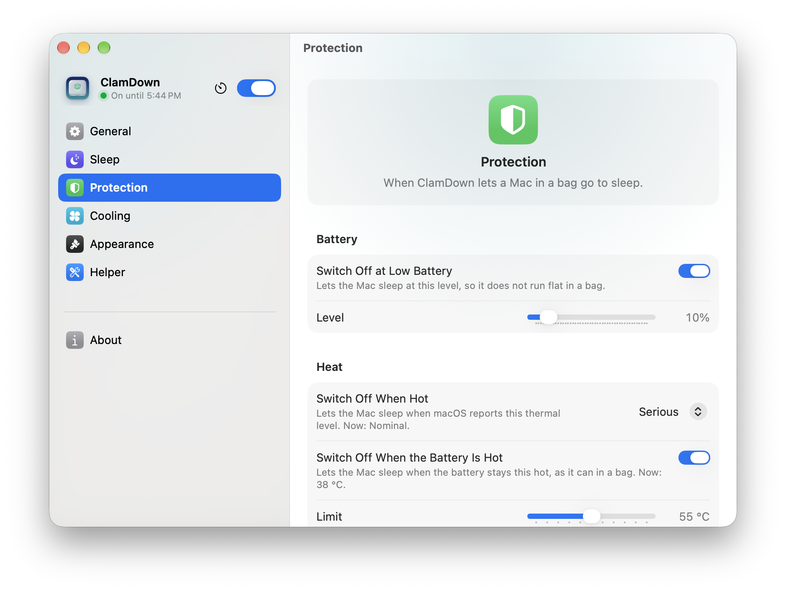
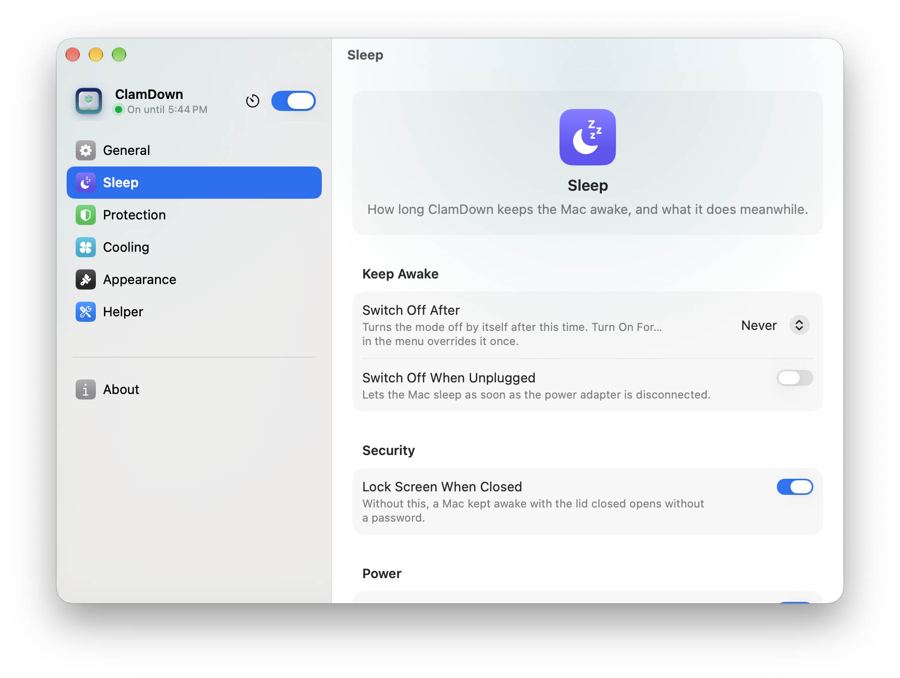

<p align="center">
  
</p>

<h1 align="center">ClamDown</h1>

<p align="center"><b>Close the lid. Your agents keep working.</b></p>

<p align="center">
  <a href="https://github.com/delef/ClamDown/releases/latest"></a>
  
  <a href="LICENSE"></a>
</p>

<p align="center">
  <a href="https://github.com/delef/ClamDown/releases/latest/download/ClamDown.dmg"><b>Download ClamDown.dmg</b></a> · <a href="https://clamdown.app">clamdown.app</a>
</p>

ClamDown is a free, open-source menu bar app that keeps coding agents working on your MacBook with the lid closed. Start a long task in Claude Code, Codex or any other agent, close the lid and put the Mac away: the agent keeps going on your own machine.

No more carrying the laptop half-open with a thumb in the hinge, and no paid cloud sessions just so a task survives a closed lid.

**Everything a closed laptop needs, in one app:**

- **Stays awake with the lid shut.** Agents, terminals, browsers, SSH sessions and downloads keep running.
- **Keeps it cool.** Drives the fans while the lid is closed, where macOS would leave them near idle. It reads the chips the way macOS does, so a few seconds of load do not make the fans roar, and it watches the battery, SSD and Wi-Fi sensors too, so a Mac in a bag still gets full speed.
- **Keeps it locked.** Locks the screen the moment the lid closes.
- **Knows when to stop.** Switches itself off and lets the Mac sleep before a low battery or high heat becomes a problem, or when your timer ends.
- **Can't get stuck on.** A root helper with a watchdog puts sleep, Low Power Mode and the fans back if the app quits, crashes or stops responding.

<p align="center">
  <picture>
    <source media="(prefers-color-scheme: dark)" srcset="docs/screenshots/cooling-dark.png">
    
  </picture>
  <picture>
    <source media="(prefers-color-scheme: dark)" srcset="docs/screenshots/protection-dark.png">
    
  </picture>
</p>
<p align="center">
  <picture>
    <source media="(prefers-color-scheme: dark)" srcset="docs/screenshots/sleep-dark.png">
    
  </picture>
  <picture>
    <source media="(prefers-color-scheme: dark)" srcset="docs/screenshots/general-dark.png">
    
  </picture>
</p>

## Why not Caffeine, `caffeinate` or a similar tool?

- **Keep-awake apps and `caffeinate`** hold a power assertion. macOS ignores it the moment the lid closes, unless an external display and power are connected.
- **A dummy display plug or an external monitor** keeps the Mac in clamshell mode, but only while it is plugged in, and with no battery, heat or fan safeguards.
- **An app that only keeps the Mac awake with the lid closed** solves half the problem. macOS keeps a closed MacBook's fans near idle even when the chip is hot, so the Mac heats up, and on battery nothing stops the agent from draining it to empty.

ClamDown keeps a closed Mac awake, drives the fans and watches the battery and the heat, so you can close the lid and stop thinking about it.

## Get started

1. **Install.** Download [`ClamDown.dmg`](https://github.com/delef/ClamDown/releases/latest/download/ClamDown.dmg), open it and drag ClamDown to Applications. A universal app for macOS 13 or later; fan control needs Apple Silicon. Or [build it yourself](docs/development.md).
2. **Allow the helper.** The setup assistant asks once. ClamDown needs a small root helper to change sleep settings and drive the fans: "Allow…" opens System Settings > General > Login Items & Extensions, switch ClamDown on there.
3. **Turn it on** from the menu bar, or for a set time with "Turn On For". Then close the lid.

ClamDown checks GitHub for updates once a day, sends nothing about you or your Mac, and asks before it installs one.

**Security note.** With ClamDown on, closing the lid locks the screen by default. If you turn off "Lock Screen When Closed", opening the lid brings you straight back to an unlocked session; lock the Mac yourself (Control-Command-Q) before you leave it unattended.

## Learn more

- [How it works](docs/how-it-works.md): every setting, default and safeguard, the fan rules, when ClamDown switches itself off.
- [Developing ClamDown](docs/development.md): building from source, tests, releases.

## Uninstall

Switch ClamDown off, use Remove Helper in Settings > Helper (it puts back the sleep and Low Power Mode settings you had before ClamDown first switched on), quit it, then delete the app. If the fans stay at a fixed speed afterwards, restart the Mac: the fans go back to macOS control on restart. If the Mac refuses to sleep afterwards, or Low Power Mode is wrong, put them back by hand:

```
sudo pmset disablesleep 0
sudo pmset -b lowpowermode 0   # or 1, whichever you had before
```

## License

Apache License 2.0. See [LICENSE](LICENSE).

The app bundles [Sparkle](https://github.com/sparkle-project/Sparkle) (MIT license), whose license ships as `Contents/Resources/Sparkle-LICENSE.txt`.
