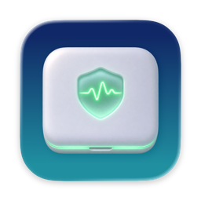

<p align="center">
  
</p>

<h1 align="center">ClamDown</h1>

<p align="center">Keep a MacBook working safely with the lid closed.</p>

<p align="center">
  <a href="https://github.com/delef/ClamDown/releases/latest"></a>
  
  <a href="LICENSE"></a>
</p>

<p align="center">
  <a href="https://github.com/delef/ClamDown/releases/latest/download/ClamDown.dmg"><b>Download ClamDown.dmg</b></a>
</p>

A macOS menu bar app that keeps a MacBook awake with the lid closed, so terminal and agent sessions keep running without a cloud machine. It drives the fans itself while the lid is closed, and switches itself off on low battery or when the Mac runs hot.

Caffeine-style tools hold a power assertion, and that does not stop the Mac from sleeping when the lid closes. ClamDown uses `pmset disablesleep`, which does, and wraps it in the safety rules a closed laptop needs.

## What it does

- One switch in the menu bar. Filled icon: on. Outline icon: off. "Turn On For" starts a timed session. The icon style is a setting.
- While on, closing the lid does not sleep the Mac. Running processes and network connections carry on.
- While on, closing the lid locks the screen (setting, on by default), so the Mac does not open without a password.
- While on with the lid closed, it drives the fans from the CPU temperature (setting, on by default). macOS keeps a closed MacBook's fans near their lowest speed even when the chip is hot; ClamDown raises them along a curve: lowest speed up to 60 °C, full speed at 85 °C (both settings). The other choices are full speed, or leaving the fans to macOS. "Only With Lid Closed" (on by default) hands the fans back to macOS while the lid is open. Fan control needs Apple Silicon; on an Intel Mac the Cooling page only shows the readings.
- On battery, it switches on Low Power Mode for the battery profile (setting, on by default) and puts your previous value back when it switches off.
- It switches itself off and lets the Mac sleep when:
  - the battery falls to the cut-off (default 10%, setting: 5–50% or off), or
  - the system thermal state reaches the cut-off (default `serious`, setting: `fair`, `serious`, `critical`, or never), or
  - the power adapter is unplugged (setting, off by default), or
  - the timer ends (setting: never, or 30 minutes to 8 hours).
- It posts a notification that names the reason whenever it switches itself off (setting, on by default).

Settings has six pages: General, Sleep, Protection, Cooling, Appearance and Helper. The Cooling page also shows the CPU temperature, each fan's speed and whether ClamDown or macOS controls the fans. The Helper page shows the helper's state and can reinstall or remove it.

## Requirements

macOS 13 or later. A universal app for Apple Silicon and Intel Macs; fan control needs Apple Silicon. Verified on Apple Silicon.

## Install

Download the notarized `ClamDown.dmg` from the [latest release](https://github.com/delef/ClamDown/releases/latest), open it, and drag ClamDown to Applications. Or build it yourself (see below).

## First run

ClamDown needs a small root helper to run `pmset`. The first click on the switch registers it, and macOS asks you to approve it: open System Settings > General > Login Items & Extensions and enable ClamDown. Click the switch again afterwards.

## Safety behavior

- **Cut-offs.** Battery and thermal cut-offs switch ClamDown off and let the Mac sleep. The battery rule applies only while running on battery, so a charging Mac at 5% stays awake. Macs without a battery have no battery rule.
- **Watchdog.** While on, the app sends the helper a heartbeat about every 30 seconds. If the heartbeat stops for about 90 seconds, or the app quits or crashes, the helper resets `disablesleep` and Low Power Mode and hands the fans back to macOS by itself.
- **Fans.** The helper hands the fans back to macOS whenever the mode switches off for any reason, the lid opens (with "Only With Lid Closed"), or the CPU temperature cannot be read. It records that it holds the fans before it touches them, so a helper restart after a crash hands them back too. It never sets a fan outside that fan's own minimum and maximum speed. Fan speed rises at once and falls by at most 150 rpm every 3 seconds, so short dips in load do not make the fans hunt.
- **Reboots.** The helper runs at load and resets any leftover state every time it starts.
- **Narrow helper.** The helper can only turn `disablesleep` on or off, turn Low Power Mode on or off for the battery profile, read both values, read the temperature sensors and fans, and set fan speeds within each fan's own range while the mode is on. It accepts connections only from the signed ClamDown app (same Team ID, same bundle identifier).

## Security note

With the mode on, closing the lid locks the screen by default. If you turn off "Lock Screen When Closed", opening the lid brings you straight back to an unlocked session; lock the Mac yourself (Control-Command-Q) before you leave it unattended.

## Uninstall

Switch ClamDown off, quit it, then delete the app. If the fans stay at a fixed speed afterwards, restart the Mac: the fans go back to macOS control on restart. If the Mac refuses to sleep afterwards, or Low Power Mode is wrong, put them back by hand:

```
sudo pmset disablesleep 0
sudo pmset -b lowpowermode 0   # or 1, whichever you had before
```

## Build from source

You need Xcode with a Swift 6 toolchain and a code-signing identity.

```
cp Config/Signing.xcconfig.example Config/Signing.local.xcconfig
# edit Config/Signing.local.xcconfig: your bundle ID and signing identities
swift test
scripts/build-app.sh debug      # Apple Development identity; use "release" for Developer ID
scripts/verify-bundle.sh
```

For a release, run `scripts/build-app.sh release`, then `scripts/notarize.sh` (notarizes and staples the app), then `scripts/make-dmg.sh` (packs it into a signed, notarized `build/ClamDown.dmg`). Notarization uploads the app and the disk image to Apple and needs a `notarytool` keychain profile (`xcrun notarytool store-credentials`).

The helper only talks to an app signed with the same Team ID as itself, so a build signed with your own identity works with its own helper and with no one else's.

## License

Apache License 2.0. See [LICENSE](LICENSE).
